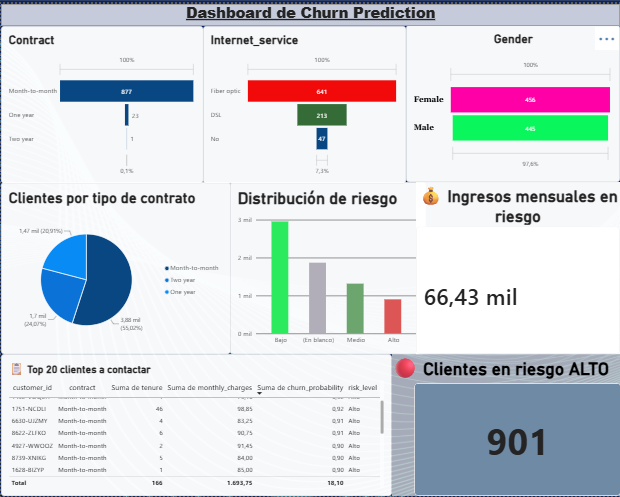

#  Churn Prediction ML Pipeline

Pipeline end-to-end para predecir abandono de clientes usando Python, SQL, n8n y Power BI.
## 📸 Vista previa del Dashboard

##  Stack Tecnológico
- **n8n**: Automatización de ingesta
- **PostgreSQL**: Almacenamiento de datos
- **Python**: Machine Learning (scikit-learn / XGBoost)
- **Power BI**: Visualización

##  Estructura del Proyecto
- `automation/`: Workflows de n8n
- `python/`: Scripts de ML
- `sql/`: Scripts de base de datos
- `bi/`: Reportes de Power BI
- `data/`: Datos (no subidos por tamaño)
- `docs/`: Documentación
## 🔄 Calidad del Modelo y Reentrenamiento

El pipeline se reentrena mensualmente de forma automática. Para simular
dinámicas realistas de churn (bajas y reactivaciones), se usan tasas
controladas con **sorteo ponderado por riesgo**: los clientes con perfil
de mayor riesgo (contrato mensual, poco tenure, cobro alto) tienen más
probabilidad de ser elegidos, pero **no es determinístico** — así se
preserva el ruido natural que existe en datos reales.

**Quality Gate:** El pipeline solo promueve un modelo nuevo si supera
ROC-AUC ≥ 0.80. Modelos con peor rendimiento se descartan automáticamente,
manteniendo siempre la mejor versión disponible.
## 🚧 Estado
En desarrollo 🚀

##  Autor
Oscar Oviedo  - [www.linkedin.com/in/oscar-alejandro-oviedo-alarcón-422b25257]